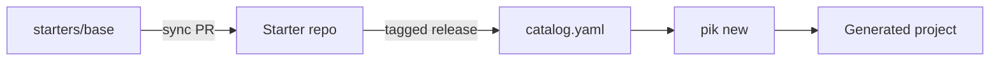

# Architecture

- **Starters stay runnable.** Each repo clones and runs as-is, so a starter is a real project, not a template full of placeholders.
- **Each starter versions itself.** It has its own CI and semver Git tags, and `catalog.yaml` pins the release that `pik` uses.
- **The baseline flows one way.** `base/` is the source of truth. A sync PR carries changes into each starter, and a checksum check stops them from drifting.
- **Checkouts stay separate.** The parent ignores starter folders, so each one keeps its own history and tooling.
- **pik lives in its own repo.** [opikdev/pik](https://github.com/opikdev/pik) reads `catalog.yaml` from `main` here, so a new starter needs no pik release. Each side tests the other: pik's CI generates every starter with the pik it builds, and the `Starters` workflow here uses the latest pik release.
